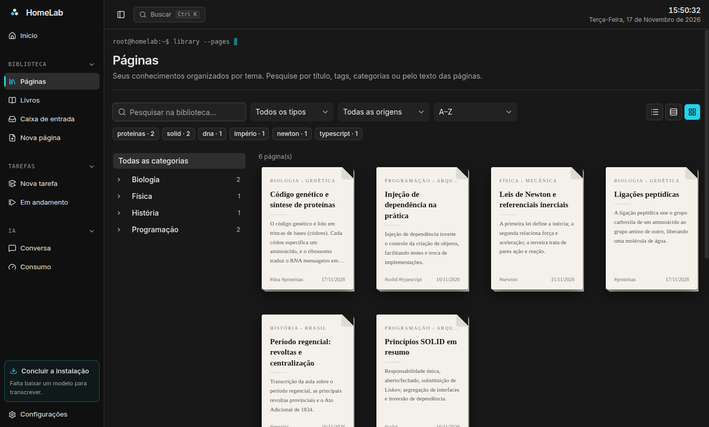
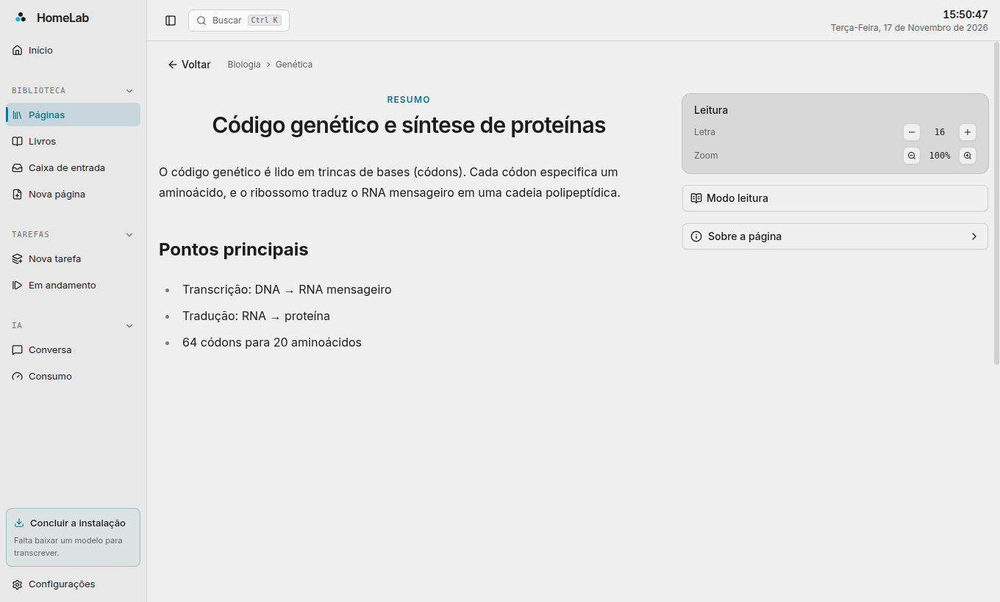
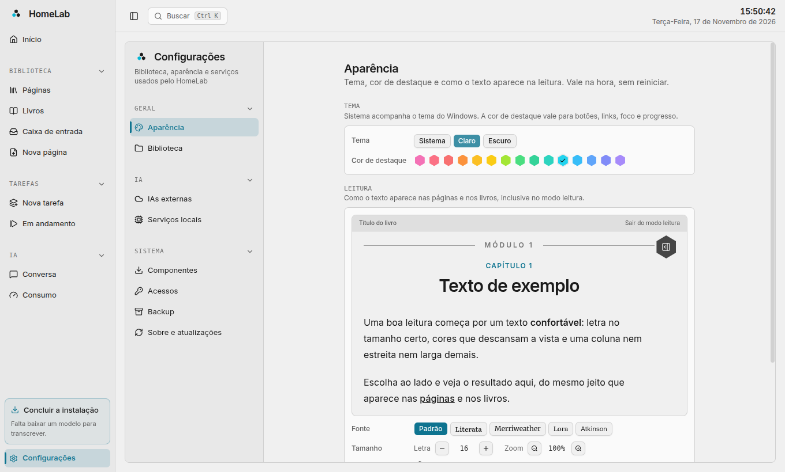

<p align="center">
  
</p>

<h1 align="center">HomeLab</h1>

<p align="center">
  <a href="https://github.com/tthheusalmeida/homelab/releases/latest"></a>
  
  <a href="LICENSE"></a>
</p>

<p align="center">
  <a href="#o-que-ele-faz">O que ele faz</a> ·
  <a href="#instalação">Instalação</a> ·
  <a href="#desenvolvimento">Desenvolvimento</a> ·
  <a href="docs/">Documentação</a>
</p>

<br />

App desktop para transformar vídeos e aulas em conhecimento organizado: baixa o vídeo, **transcreve no seu computador**, resume com IA e guarda tudo numa biblioteca de páginas em Markdown, com busca, livros e conversa com IA. Funciona no **Windows** e no **Linux**; seus dados ficam em pastas comuns do seu computador.

<p align="center">
  
</p>

## O que ele faz

- 🎬 **Tarefas de vídeo:** cole o link do vídeo (YouTube e outras plataformas); o app extrai o áudio, transcreve e, se quiser, gera um resumo.
- 🔒 **Transcrição local:** roda no seu computador (no Windows usa a placa NVIDIA quando existe), sem enviar o áudio para a nuvem.
- 📚 **Biblioteca:** páginas em Markdown organizadas por categorias e tags, com busca pelo título e pelo texto, modo leitura e livros.
- 🤖 **IA à sua escolha:** Gemini (com a sua chave, guardada cifrada) ou Ollama local, com conversa e controle de consumo.
- ⌨️ **Atalhos e paleta de comandos:** `Ctrl K` abre a busca em qualquer tela; `G` e uma letra navegam entre as telas.
- 🗂️ **Seus dados, sua pasta:** tudo fica numa pasta única, com backup e restauração em `.zip`.

<table>
  <tr>
    <th align="center" width="33%">Leitura</th>
    <th align="center" width="33%">Paleta de comandos</th>
    <th align="center" width="33%">Aparência</th>
  </tr>
  <tr>
    <td></td>
    <td></td>
    <td></td>
  </tr>
</table>

Tema claro, escuro ou do sistema, e cor de destaque à escolha em **Configurações > Aparência**.

## Instalação

Baixe a última versão em [Releases](https://github.com/tthheusalmeida/homelab/releases/latest).

**Windows:** execute `HomeLab-Setup-<versão>.exe`. O instalador não pede administrador. Como não é assinado, o SmartScreen pode avisar: clique em *Mais informações > Executar assim mesmo*.

**Linux:** baixe `HomeLab-<versão>.AppImage`, marque como executável e rode:

```bash
chmod +x HomeLab-*.AppImage
./HomeLab-*.AppImage
```

> [!NOTE]
> Em distribuições recentes pode ser preciso instalar o FUSE 2 (`sudo apt install libfuse2`, ou `libfuse2t64` no Ubuntu 24.04).

No primeiro uso, o assistente de instalação baixa só o que o seu computador precisa (transcrição, processamento de áudio e modelos). No Windows o app avisa quando há versão nova e atualiza baixando só o que mudou; no Linux ele avisa e abre a página do Release.

## Desenvolvimento

Electron + React + IPC, com o back em Nest usado só como contêiner de injeção de dependência (sem HTTP, sem porta).

```bash
npm install --legacy-peer-deps
npm run dev        # Vite + Electron
npm test           # Jest (main e back)
npm run test:renderer
npm run lint
```

A documentação fica em [`docs/`](docs/): arquitetura, canais IPC, empacotamento, versionamento e regras de negócio. Mudanças seguem [Conventional Commits](docs/versionamento.md) e o release sai automático a cada `feat` ou `fix` na `main`.

## Licença

[MIT](LICENSE)
