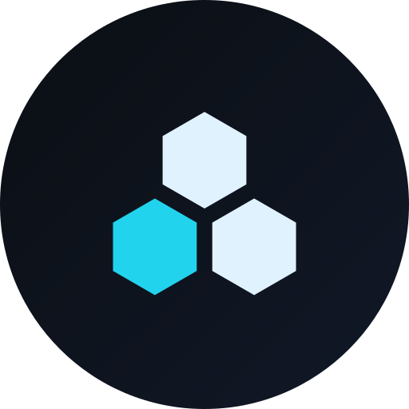
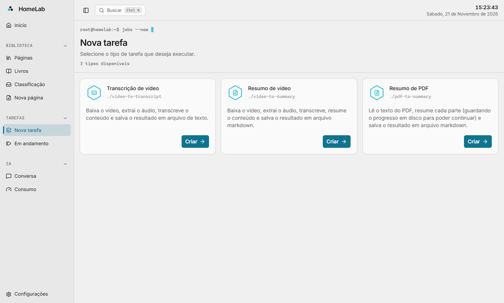
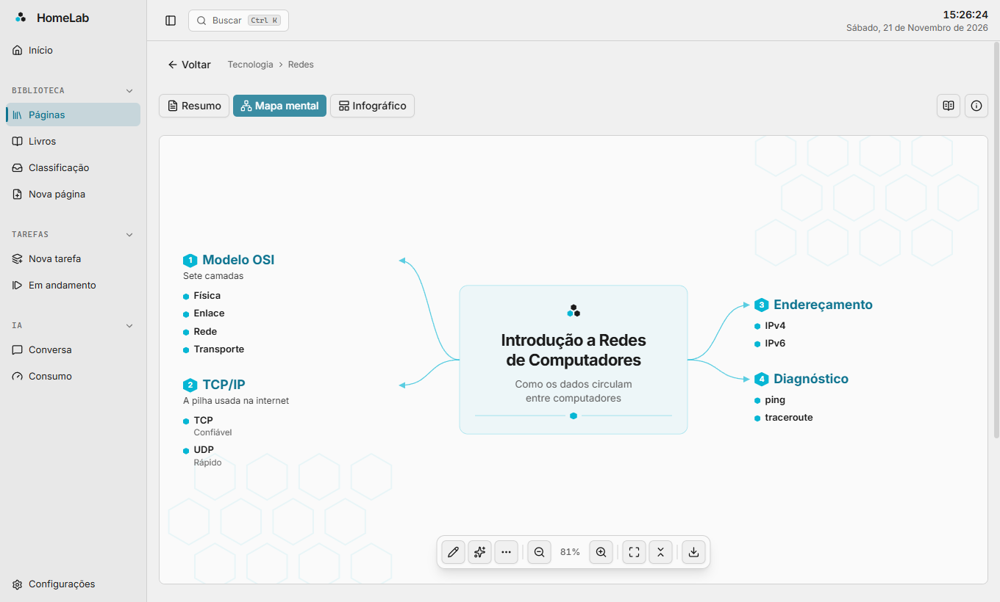
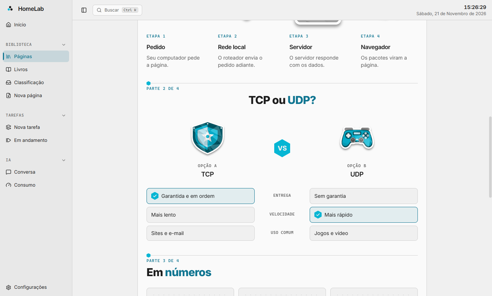
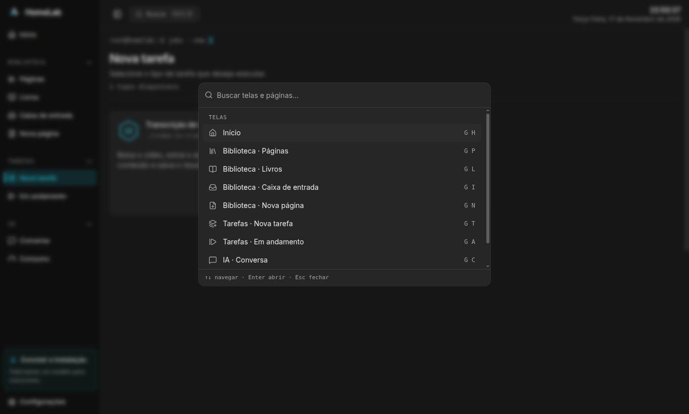

<p align="center">
  
</p>

<h1 align="center">HomeLab</h1>

<p align="center"><strong>Transforme vídeos, aulas e PDFs em conhecimento organizado, no seu computador.</strong></p>

<p align="center">
  <a href="https://github.com/tthheusalmeida/homelab/releases/latest"></a>
  
  <a href="LICENSE"></a>
</p>

<p align="center">
  <a href="#como-funciona">Como funciona</a> ·
  <a href="#recursos">Recursos</a> ·
  <a href="#privacidade-e-seus-dados">Privacidade</a> ·
  <a href="#instalação">Instalação</a> ·
  <a href="#desenvolvimento">Desenvolvimento</a> ·
  <a href="docs/">Documentação</a>
</p>

<br />

<p align="center">
  
</p>

O **HomeLab** é um app desktop (Windows e Linux) para quem aprende e pesquisa com vídeos, aulas e documentos. Você cola um link ou escolhe um PDF; o app **baixa, transcreve no seu computador, resume com IA** e guarda tudo numa biblioteca de páginas em Markdown, que você pesquisa, lê, organiza em livros e conversa com a IA. Cada resumo ainda vira **mapa mental** e **infográfico**.

## Como funciona

1. **Traga o conteúdo:** link de vídeo (YouTube e outras plataformas) ou um PDF.
2. **Deixe o app trabalhar:** extrai o áudio, transcreve, divide em partes e resume com a IA que você escolheu, com o progresso visível.
3. **Revise e estude:** leia o resumo, abra o mapa mental, gere um infográfico e converse com a IA sobre o assunto.
4. **Guarde:** tudo vira páginas na sua biblioteca, numa pasta sua, com busca e backup.

## Recursos

### Tarefas: do vídeo ou PDF ao resumo

- 🎬 **Transcrição e resumo de vídeo:** cole o link; o app cuida do download, do áudio e da transcrição. Vídeos que pedem login abrem uma janela própria do app, com cookies temporários.
- 📄 **Resumo de PDF:** lê o texto, divide em partes e resume cada uma. O progresso fica em disco, então dá para **retomar** de onde parou.
- 🔒 **Transcrição local:** roda no seu computador (no Windows usa a placa NVIDIA quando existe), sem enviar o áudio para a nuvem.
- ⏱️ **Transcrição com tempo:** marcas `[HH:MM:SS]`, linha do tempo lateral e horários que abrem o vídeo no ponto certo.
- 🔔 **Aviso do sistema** quando uma tarefa termina.

<p align="center">
  
</p>

### Estudo: mapa mental e infográfico

- 🧠 **Mapa mental:** gerado pela IA quando você abre a aba, em colmeia. Você edita, guarda e baixa em PNG, com ou sem fundo.
- 🗺️ **Infográfico:** a IA conta a história do resumo em seções, cada uma no modelo que melhor a mostra (passos, comparativo, números, ranking, ciclo e outros), com um banco de peças ilustradas. Baixe em PNG, SVG ou PDF. Dá para ampliar (botões ou Ctrl + roda do mouse) e, com a barra lateral recolhida, ela reaparece ao encostar o mouse na borda e some sozinha depois.

<table>
  <tr>
    <th align="center" width="50%">Mapa mental</th>
    <th align="center" width="50%">Infográfico</th>
  </tr>
  <tr>
    <td></td>
    <td></td>
  </tr>
</table>

### Biblioteca e leitura

- 📚 **Páginas em Markdown** organizadas por categorias e tags, com busca pelo título e pelo texto.
- 📖 **Modo leitura** com sumário, tamanho de letra e zoom, e **livros** para agrupar páginas.
- 🗂️ **Classificação:** páginas novas chegam a uma caixa de entrada para você revisar antes de publicar.

### IA à sua escolha

- 🤖 **Gemini** (com a sua chave, guardada cifrada) ou **Ollama** local.
- ✍️ **Prompts seus:** mude o jeito de a IA trabalhar, guarde versões com nome (por exemplo, uma para revisão e outra para prova) e escolha qual usar. Há exemplos prontos para começar (por exemplo, "Para prova"), o padrão do app fica sempre à mão e o formato da resposta não quebra.
- 💬 **Várias conversas** salvas, com aviso quando o contexto fica grande.
- 📊 **Consumo:** acompanhe requisições e custo da IA.

### Rápido e agradável de usar

- ⌨️ **Paleta de comandos:** `Ctrl K` abre a busca em qualquer tela; `G` e uma letra navegam entre as telas.
- 🔎 **Buscar no texto:** `Ctrl F` procura em livros, transcrições e resumos, achando primeiro a frase inteira ("casa da vida") e destacando cada ocorrência.
- 🎨 **Identidade Colmeia:** tema claro, escuro ou do sistema, cor de destaque à escolha e animações suaves (respeita "reduzir movimento").
- 🪶 **Leve em PCs fracos:** telas carregadas sob demanda e consultas mais calmas.

<table>
  <tr>
    <th align="center" width="33%">Leitura</th>
    <th align="center" width="33%">Paleta de comandos</th>
    <th align="center" width="33%">Aparência</th>
  </tr>
  <tr>
    <td></td>
    <td></td>
    <td></td>
  </tr>
</table>

### Instalação e manutenção sem dor de cabeça

- 🧩 **Componentes sob demanda:** o assistente de primeiro uso baixa só o que o seu computador precisa, com conferência de integridade.
- 🔄 **Atualização:** o app avisa quando há versão nova e, no Windows, baixa só a diferença.
- 💾 **Backup e restauração** em um único `.zip`, escolhendo o que entra.

## Privacidade e seus dados

- A transcrição acontece **no seu computador**; o áudio não vai para a nuvem.
- Só o **texto** vai para a IA que você configurou (Gemini ou Ollama local).
- A chave do Gemini fica **cifrada** pelo sistema e não entra no backup.
- Páginas, livros, conversas e histórico ficam numa **pasta única** de fácil backup, em formatos abertos (Markdown e JSON).
- Não existe servidor do HomeLab nem conta: o app não abre portas.

## Instalação

Baixe a última versão em [Releases](https://github.com/tthheusalmeida/homelab/releases/latest).

**Windows:** execute `HomeLab-Setup-<versão>.exe`. O instalador não pede administrador. Como não é assinado, o SmartScreen pode avisar: clique em *Mais informações > Executar assim mesmo*.

**Linux:** baixe `HomeLab-<versão>.AppImage`, marque como executável e rode:

```bash
chmod +x HomeLab-*.AppImage
./HomeLab-*.AppImage
```

> [!NOTE]
> Em distribuições recentes pode ser preciso instalar o FUSE 2 (`sudo apt install libfuse2`, ou `libfuse2t64` no Ubuntu 24.04).

No primeiro uso, o assistente de instalação baixa só o que o seu computador precisa (transcrição, processamento de áudio e modelos). No Linux o app avisa de versão nova e abre a página do Release.

## Desenvolvimento

Electron + React + IPC, com o back em Nest usado só como contêiner de injeção de dependência (sem HTTP, sem porta).

```bash
npm install
npm run dev        # Vite + Electron
npm test           # Jest (main e back)
npm run test:renderer
npm run lint
```

A documentação fica em [`docs/`](docs/): arquitetura, canais IPC, empacotamento, versionamento e regras de negócio. Mudanças seguem [Conventional Commits](docs/versionamento.md) e o release sai automático a cada `feat` ou `fix` na `main`.

## Licença

[MIT](LICENSE)
